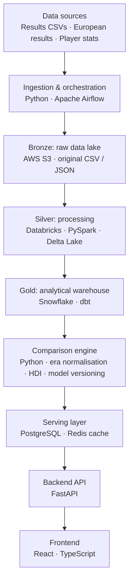

# Premier League Intelligence Platform

A full-stack football analytics platform that compares Premier League teams and players across different eras to find out which were the most dominant, while accounting for how strong their competition was.

The platform goes beyond raw statistics to answer questions such as:

- Was Arsenal's unbeaten 2003/04 season more dominant than Manchester City's 100-point 2017/18 season?
- Was Thierry Henry more impressive relative to his era than Mohamed Salah?
- Does winning the Premier League mean more when other English clubs are performing strongly in Europe?
- Which Premier League team achieved the greatest dominance relative to its competition?

> **Status:** early development. The MVP (historical team comparison) is in progress. See the [roadmap](#roadmap).

---

## Core features

| Feature | Description |
|---|---|
| Historical team comparison | Compare team-seasons using points per game, win rate, goal difference, possession and other available statistics |
| Historical player comparison | Compare goals, assists and per-90 statistics, plus performance relative to players of the same era |
| Dominance ranking engine | Rank Premier League teams with a custom **Historical Dominance Index (HDI)** |
| League strength analysis | Measure the strength of domestic competition using European results and league competitiveness |
| Interactive dashboard | Historical rankings, charts, comparisons and an explanation of every score |
| Customisable rankings | Adjust metric weightings and see how the rankings change |

### Fairness between eras

Comparing raw totals across eras is misleading, so the platform adjusts for differences such as:

- **Season length.** 1992/93 to 1994/95 had 42 matches per team; later seasons have 38. All metrics use per-game rates.
- **Data availability.** Possession, shots and xG are only available for later seasons. Scores are computed from the metrics a season actually has, and missing data is shown rather than hidden.
- **Era context.** Player and team performance is also measured relative to the rest of the same season, not only in absolute terms.

---

## Historical Dominance Index (HDI)

The HDI combines three independent measures, each normalised to 0–100:

| Component | Measures |
|---|---|
| **D**: domestic dominance | Points per game, win rate, goal difference per game, title margin |
| **E**: European strength | How well *other* English clubs performed in Europe, relative to their domestic standing. The team being scored is excluded so it isn't rewarded twice for its own success. |
| **C**: domestic parity | How closely matched the rest of the league was |

$$
L = 0.75E + 0.25C
$$

$$
HDI = D \times \left(0.80 + 0.20 \cdot \frac{L}{100}\right)
$$

The formula and weights are provisional and will be validated against historical data. Every formula configuration is stored as a versioned model, so any score can be traced back to the exact weights that produced it. Users can also supply their own weights.

---

## Architecture

This is the target end-state architecture. It is being built in stages (see the [roadmap](#roadmap)), and the MVP runs entirely locally.



Cross-cutting concerns: **Docker**, **Terraform**, **AWS**, **GitHub Actions** (CI/CD), **monitoring** (logs, metrics, alerts) and **data quality** (tests, validation, lineage).

---

## Tech stack

The MVP uses a lightweight local stack. Its layout mirrors the end-state platform (medallion layers, dbt models, a separate scoring engine), so later stages swap the tools without rewriting the logic.

| Area | MVP | End state |
|---|---|---|
| Language | Python 3.12 (uv), TypeScript | Same |
| Ingestion | Python scripts (pandas) | Python, **Apache Airflow** (scheduling, retries, backfills) |
| Raw storage | Local files (`data/raw`) | **AWS S3** (Bronze) |
| Processing | pandas | **Databricks**, **PySpark**, **Delta Lake** (Silver) |
| Transformation | **dbt Core** on PostgreSQL | **dbt** on **Snowflake** (Gold) |
| Warehouse | PostgreSQL | **Snowflake** |
| Data quality | dbt tests, pytest | dbt tests, **Great Expectations**, lineage via dbt docs |
| Scoring engine | Python (pandas, NumPy) | Python, versioned model configurations |
| Serving database | PostgreSQL (SQLAlchemy 2.0, Alembic) | **AWS RDS PostgreSQL**, **Redis** cache |
| API | **FastAPI**, Pydantic | Same, containerised |
| Frontend | React, Vite, TanStack Query, Recharts, Tailwind | Same, hosted on S3 + CloudFront |
| Containers | **Docker Compose** | **Docker**, **AWS ECS Fargate** |
| Infrastructure as code | — | **Terraform** |
| CI/CD | **GitHub Actions** (lint, tests) | GitHub Actions (tests, dbt build, image publish, Terraform plan/apply) |
| Observability | Structured logging | **CloudWatch** or **Prometheus + Grafana**, alerting |

---

## Data model

| Table | Purpose |
|---|---|
| `clubs` | Unique club identities, with historical name variants mapped to one club |
| `seasons` | Seasons from 1992/93 onward, including matches per team |
| `matches` | Match results and fixture information |
| `team_seasons` | Aggregated domestic performance by club and season |
| `players` | Player information |
| `player_seasons` | Player performance by season and club |
| `european_campaigns` | European competition results for English clubs |
| `team_match_stats` | Possession, shots and advanced statistics where available |
| `model_versions` | Scoring formula configurations and weights |
| `dominance_scores` | Calculated HDI scores and their components |

The warehouse stores the historical analytical datasets. PostgreSQL serves precomputed rankings and comparisons to the API.

---

## Roadmap

### Stage 1: MVP, historical team comparison
- [ ] Docker Compose with PostgreSQL; schema managed by Alembic
- [ ] Ingest historical Premier League results (raw → staging → marts)
- [ ] dbt models for `team_seasons`, with tests checking final tables against official standings
- [ ] Domestic dominance score (D) from per-game metrics
- [ ] FastAPI endpoints for seasons, league tables, team-season comparison and rankings
- [ ] React frontend: rankings, side-by-side comparison, season view
- [ ] GitHub Actions running linting and tests

### Stage 2: League strength and HDI
- [ ] Ingest historical European competition results
- [ ] European-strength (E) and domestic-parity (C) metrics
- [ ] Full HDI with versioned model configurations
- [ ] User-adjustable weightings in the UI

### Stage 3: Data engineering platform
- [ ] Raw data landed in AWS S3 (Bronze)
- [ ] Databricks / PySpark cleaning into Delta tables (Silver)
- [ ] dbt models running on Snowflake (Gold)
- [ ] Airflow DAGs orchestrating ingestion, processing and transformation
- [ ] Data quality checks and lineage

### Stage 4: Players and production deployment
- [ ] Historical player statistics with era-adjusted, per-90 comparisons
- [ ] AWS infrastructure provisioned with Terraform
- [ ] Containerised services deployed on ECS
- [ ] Full CI/CD pipeline
- [ ] Monitoring, metrics and alerting

---

## Getting started

### Ingest the raw data

Requires Python 3.11+.

```bash
pip install -r requirements.txt
python -m ingestion.run          # writes data/raw/premier_league_raw.json
pytest
```

The pipeline extracts three datasets into one JSON file (the Bronze layer), validates match counts per season, and records source metadata:

| Dataset | Source | Coverage |
|---|---|---|
| `football_data_matches` | [football-data.co.uk](https://www.football-data.co.uk/englandm.php) | 1993/94 onward: results, shots, corners, fouls, cards, odds (where available) |
| `engsoccerdata_england_matches` | [engsoccerdata](https://github.com/jalapic/engsoccerdata) | Top flight from 1992/93, used to fill the 1992/93 gap and cross-check results |
| `champions_league_matches` | [engsoccerdata](https://github.com/jalapic/engsoccerdata) | European Cup / Champions League, 1992/93 to 2017/18 |

| `european_campaigns` | [Wikipedia](https://en.wikipedia.org/wiki/UEFA_Champions_League) season pages | English clubs in the Champions League, UEFA Cup / Europa League, Cup Winners' Cup and Conference League, 1992/93 onward: the furthest round each club reached |

Known gaps: `european_campaigns` records the round reached, not match-level results (the Champions League has match-level data to 2017/18 in `champions_league_matches`). Intertoto Cup and Super Cup entries are excluded. The first run makes several hundred polite requests to Wikipedia and takes ~30 minutes; pages are cached in `data/cache/`, so reruns take seconds. Player statistics will be added in a later stage.

Data credit: football-data.co.uk, engsoccerdata by James Curley (free for non-commercial use), and Wikipedia (CC BY-SA 4.0).
